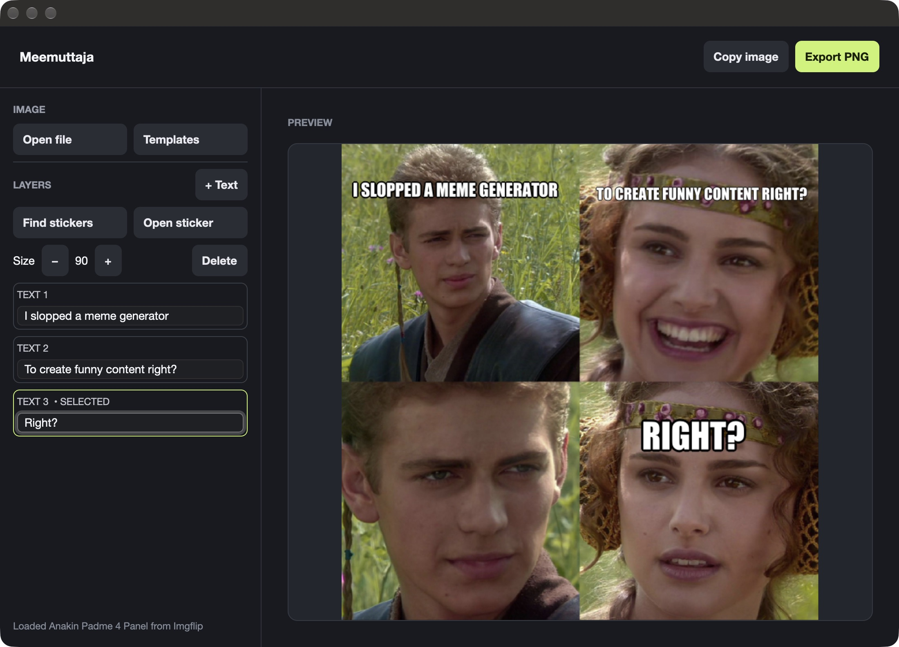

# Meemuttaja

A small desktop meme editor built with Rust and [GPUI Kit](https://github.com/longbridge/gpui-kit). Start with an image, add captions and stickers, then save or copy the result.

Meemuttaja is for making memes without the watermarks and noisy interfaces found in many online generators. It runs on your computer and exports images without adding a watermark.



## Install

Download a build from [GitHub Releases](https://github.com/vivainio/meemuttaja/releases):

- **macOS (Apple Silicon):** Extract `meemuttaja-macos-arm64.zip` and move `Meemuttaja.app` to Applications.
- **Windows (x64):** Download and run `meemuttaja-windows-x64.exe`.

The builds are unsigned. Your operating system may ask you to confirm that you want to open them. Draft releases are visible only to repository collaborators with access.

## Make a meme

1. Open an image from your computer, or choose **Templates** to browse Imgflip's catalog.
2. Enter text in a layer or add another with **+ Text**. Drag text on the preview to position it.
3. Add a sticker from a local image or search Wikimedia Commons. Select a layer to change its size or delete it.
4. Choose **Export PNG** to save the full-size image, or **Copy image** to put it on the clipboard.

PNG, JPEG, WebP, GIF and BMP images are supported; animated images use their first frame. Captions use Impact or an available bold system font. Template and sticker searches need an internet connection. Wikimedia Commons results are added at thumbnail resolution, and some have opaque backgrounds; each result links to its source and license.

## Build from source

Install a recent [Rust toolchain](https://rustup.rs/), clone the repository, and run:

```sh
git clone https://github.com/vivainio/meemuttaja.git
cd meemuttaja
cargo run --release
```

On Windows, use the MSVC Rust toolchain and Visual Studio C++ build tools. To package a macOS app bundle after building, run:

```sh
scripts/package-macos.sh
```

The bundle is written to `dist/Meemuttaja.app`.

## Releases

Publishing a GitHub release builds the macOS and Windows assets. To test a draft first, run the **Build desktop releases** workflow manually with the draft's tag; it attaches the builds to that draft.

## License

The application code is licensed under the [MIT License](LICENSE). The Me Gusta icon is a third-party image; see its [source and rights note](assets/ICON-SOURCE.md).
